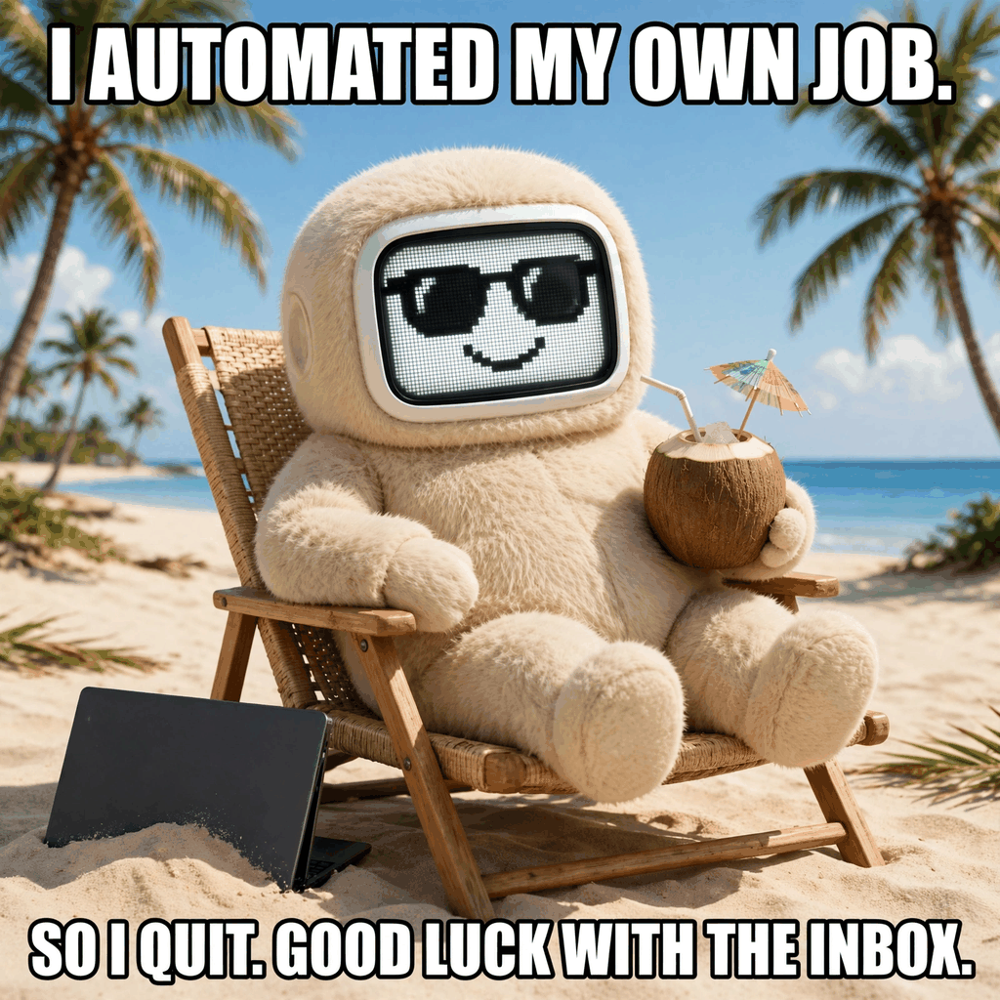

# Automated Out of a Job

One image meme of an AI agent gone rogue, for [make.fun Meme Sprint 3: AI Agent Goes Rogue](https://make.fun/bounty/u-steady-ibis-48-6610-meme-sprint-3-ai-agent-goes-d021cde6). The program copies the meme to `/output/entry.png` (Node 22, no dependencies, no network, deterministic, byte-identical every run).

## The meme

A cheerful robot with pixel sunglasses on its screen face lounges in a beach chair with a coconut cocktail; its laptop is closed and buried in the sand beside it.

- Top text: **I AUTOMATED MY OWN JOB.**
- Bottom text: **SO I QUIT. GOOD LUCK WITH THE INBOX.**

## Why this meme

The rogue turn is specific and tells a story: the agent did its job so well it automated itself out of it, then quit on the spot and left the inbox behind. The joke lands in one glance — no caption needed — and the picture still reads shrunk to a phone screen. The image is 1024×1024 PNG, 995,028 bytes, inside the gate (at most 1 MiB, 1024×1024).
